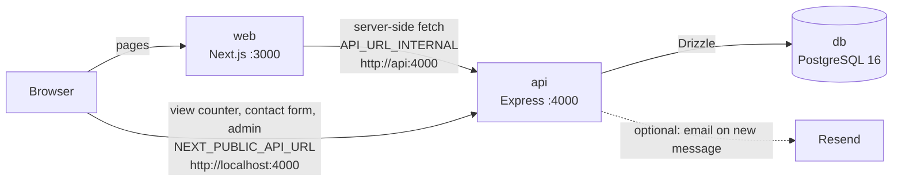

# Portfolio

My personal portfolio: a Next.js website, an Express API with PostgreSQL, and a small admin panel to manage projects and contact messages. The whole stack runs locally with one command.

**Stack:** TypeScript everywhere · Next.js (App Router) + Tailwind CSS + MDX · Express + Drizzle ORM + Zod + JWT · PostgreSQL · Vitest + Playwright · Docker Compose · GitHub Actions

## Architecture



- **web** renders every page on the server. It fetches projects from the API, and adds the long case studies from MDX files.
- **Browser-side calls go straight to the API:** the view counter, the contact form and the whole admin panel.
- **api** validates every request with Zod, stores data in Postgres, and protects admin routes with a JWT.
- **db** is plain Postgres. The api container applies migrations and seeds the four resume projects when it starts.

```
apps/
  api/                 Express API (see apps/api/README.md for endpoints)
    src/routes/        public.ts, auth.ts, admin.ts
    src/db/            schema, migrations runner, seed
    drizzle/           SQL migrations
    tests/             API tests against an in-memory Postgres (PGlite)
  web/                 Next.js website
    app/               pages: home, projects, experience, about, resume, contact, admin
    components/        UI; components/admin/ is the admin panel
    content/projects/  one MDX case study per project, named by slug
    lib/               API client, env checks, profile data, card highlights
    e2e/               Playwright tests and a mock API
scripts/demo.sh        resets the local stack to a clean demo state
```

## Run it

You need Docker, and Node.js 20+ for the one-time password hash.

```bash
npm install
cp .env.example .env
npm run hash-password -w apps/api -- "a-strong-password"   # paste the output into ADMIN_PASSWORD_HASH (keep the single quotes)
# in .env, also set JWT_SECRET (a long random string) and ADMIN_EMAIL
docker compose up --build
```

- Site: http://localhost:3000
- Admin: http://localhost:3000/admin
- API health: http://localhost:4000/health

If port 3000 is taken, set `WEB_PORT=3002` in `.env` and add `http://localhost:3002` to `CORS_ORIGINS`. Postgres is published on host port 5434, so it doesn't clash with a local Postgres on 5432.

**Reset to a clean demo:** `npm run demo` deletes the local database and restarts everything with only the seeded projects. It asks first; `npm run demo -- --yes` skips the question.

**Develop with hot reload:** `npm run dev` starts Postgres in Docker, then runs the API and the website on your machine.

## Deployment

Live at **https://prathameshpatil.vercel.app** (API: https://prathameshpatil-api.vercel.app/health).

| Piece | Where | How |
|---|---|---|
| Website | Vercel project `prathameshpatil`, root `apps/web` | Next.js, detected by Vercel |
| API | Vercel project `prathameshpatil-api`, root `apps/api` | `api/index.ts` exports the same Express app that Docker runs; `vercel.json` routes every path to it |
| Database | Neon Postgres (free), connected to the API project | Adds `DATABASE_URL`; each API deploy runs the migrations and the seed (`vercel-build`) |

Deploy from the repo root, so Vercel sees the npm workspace and its lockfile (IDs are in each app's `.vercel/project.json`):

```bash
VERCEL_ORG_ID=<org> VERCEL_PROJECT_ID=<api project> npx vercel deploy --prod   # API first
VERCEL_ORG_ID=<org> VERCEL_PROJECT_ID=<web project> npx vercel deploy --prod   # then the website
```

`.vercelignore` keeps `.env` files, build output and private PDFs out of the upload. Environment variables live in each Vercel project. On Vercel, each running copy of the API keeps its own rate-limit counts, so the limits there are approximate.

## Checks

```bash
npm run typecheck   # both apps
npm run lint        # both apps
npm test            # 18 API tests (Vitest + PGlite, no Docker needed)
npm run test:e2e    # 13 Playwright tests against the production build and a mock API
```

GitHub Actions runs all of these on every push and pull request. It also builds the web app and both Docker images.

## Design decisions

- **The API is the only source of project data.** The admin panel edits projects in Postgres, and the site shows the change on the next page load. Long-form case studies are MDX files in the repo (`content/projects/<slug>.mdx`), because prose and diagrams are easier to write and review as files than in a form.
- **Two URLs for the same API.** Server Components reach the API by its Docker service name (`http://api:4000`); the browser uses `http://localhost:4000`. `NEXT_PUBLIC_API_URL` is the only public variable, and since Next.js bakes it in at build time, it's a Docker build argument.
- **Fail fast on bad configuration.** Both apps validate their environment variables with Zod at startup. A wrong value stops the process with a message naming the variable, instead of failing later on the first request.
- **One admin, no users table.** The admin email and a bcrypt hash live in `.env`, and login returns a 2-hour JWT.
  - **Where the browser keeps it:** `sessionStorage`, which is never sent automatically with requests, so there's no CSRF risk.
  - **Expired or invalid token:** any 401 sends you back to the login page.
  - **Trade-off:** an httpOnly cookie would also hide the token from scripts, but would need CSRF protection.
- **The database enforces correctness.** View counts use a single `UPDATE ... SET views = views + 1`, so simultaneous visits can't overwrite each other; a test fires 50 at once and checks for exactly 50.
- **Forms validate twice.** The browser mirrors the API's Zod rules to give instant, accessible errors (focus moves to the first invalid field). The API is still the authority, and its field errors are mapped back onto the form. The contact form also has a rate limit and a honeypot field for bots.
- **Never claim what isn't there.** The "Open demo" button appears only when a project has a demo URL, and a missing fact shows as a visible TODO instead of a guess.
- **Few dependencies.** No UI kit or animation library: Tailwind, CSS animations that respect reduced-motion, and an inline-SVG diagram component for the case studies.
- **Startup order through healthchecks.** db → api (migrates and seeds, then reports healthy) → web, so the site never starts against a missing API. The seed only inserts missing projects, so restarts never overwrite admin edits.
- **Rendered per request.** Pages always show live data, and the build doesn't need the API. Fine for a local site; on a public one I'd cache pages and revalidate when the admin changes data.
- **Accessibility was checked, not assumed.** axe-core reported 0 violations on 10 pages in both themes, every text colour meets WCAG AA contrast, and the mobile menu works by keyboard.

## 5-minute demo script

Run `npm run demo` first, so the database is clean. Keep a second tab on the admin login.

**1. The site (1.5 min)**
- **Home:** the availability pill, the summary and the core stack. Each featured project card shows the project's pipeline and one real, sourced result.
- Toggle dark mode.
- Narrow the window to phone width: the layout reflows and the menu collapses. Open it, then press Escape to close it.

**2. A case study (1 min)**
- **Open Slotwise:** problem, architecture diagram, decisions, results.
- The view counter goes up by one, and only once per browser session; refresh to show it doesn't count again.
- The "Open demo" button is here because Slotwise has a working live URL. Projects without a working live URL (the loan agent) get no button.

**3. Contact form (1 min)**
- Submit it empty: the errors appear and focus jumps to the first field.
- Fill it in and send it.
- *Talking point:* the message is saved first, and the notification email is optional, so email trouble can't lose a message.

**4. Admin (1.5 min)**
- **Log in.** The dashboard shows the new unread message and the view you just made. Open the inbox and mark the message read.
- **Projects:** unpublish a project, then reload the public Projects page in the other tab: it's gone. Publish it again.
- *Talking point:* every admin request carries the JWT, and an expired token sends you back to login. One of the Playwright tests checks exactly that.

**Wrap-up, if there's time:** show `docker-compose.yml` (the healthcheck chain), the CI workflow, and one test, for example the 50 concurrent views.

## Content still to fill in

The site never shows a made-up number: wherever a fact is missing, the page shows a visible TODO. Search for `<Todo` in `apps/web/content/projects/`.
